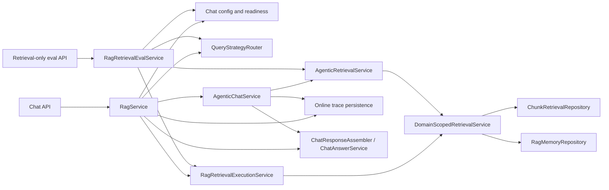

# 백엔드 기능 경계와 클래스 의존 관계

2026-11-25 기준. 최초 전수 조사 기준 커밋은 `0e6c270`이다. 아래 의존 관계는 Java 소스의 타입 참조와 생성자 주입을 기준으로 읽는다. SQL, 트랜잭션, subprocess, 정적 파일 경로는 기능별 실행 흐름에 기록했다. 후속 재분류 결과가 반영된 운영·테스트 패키지의 전체 선언 목록은 별도로 확인할 수 있다. [백엔드 소스 인벤토리](backend_source_inventory.md)

## 구조를 나눈 기준

하나의 기능이 받는 요청, 실행 로직, JDBC 쿼리, 응답 레코드를 같은 패키지에 둔다. 다른 기능이 필요한 데이터는 해당 기능의 저장소나 응용 서비스를 요청한다. 부트스트랩과 공통 HTTP 예외 응답은 각 진입점에 공통으로 적용되므로 루트 패키지에 둔다. Spring Boot의 루트 구성과 기능별 패키지 관례를 따른다. [Spring Boot 코드 구조 가이드](https://docs.spring.io/spring-boot/reference/using/structuring-your-code.html)

이전에는 콘솔과 코퍼스에 하위 패키지가 있었어도 공용 서비스와 저장소가 여러 기능의 실제 메서드와 SQL을 소유했다. 특히 `AdminConsoleRepository`가 기존 하위 저장소를 다시 묶고, 그 저장소의 응답 타입을 하위 저장소가 참조하는 순환 관계가 있었다. `RagRepository` 역시 검색과 메모리 조회, 채팅 이력 쓰기, 실험 조회, 재색인을 한 타입으로 노출했다. 현재 구조에서는 세 공용 저장소를 없애고, 소비자가 필요한 기능의 저장소에 직접 의존하도록 했다.

## 관리자 기능의 실행 흐름

| 기능 | 진입점과 호출 관계 | 데이터와 실행 경계 |
| --- | --- | --- |
| 합성 질의 | `SyntheticGenerationController` → `SyntheticGenerationService` → `AdminSyntheticMethodRepository`, `SyntheticGenerationRepository`, `ConsoleScopeService`, `LlmJobService` | 전략별 A–G raw 테이블과 읽기용 union view를 사용한다. 실행은 메서드·소스 범위를 검증한 뒤 배치와 job을 만들고 Python에 넘긴다. |
| 게이팅 | `GatingController` → `GatingService` → `GatingRepository`, 합성 질의 배치 조회, 런타임 카탈로그, 작업 서비스 | 명시적으로 선택된 generation batch·run을 기준으로 실행한다. 정리, 배치 생성, 작업 등록의 트랜잭션을 유지한다. |
| 평가 데이터셋 | `EvalDatasetController` → `EvalDatasetService` → `AdminEvalDatasetRepository`. 삭제는 `EvalDatasetDeletionController` → `EvalDatasetDeletionService` → 데이터셋 저장소와 `RagTestHistoryService` | 기본 데이터셋 초기화와 아이템 조회는 `dataset`에 있다. `dataset.lifecycle`은 사용자 데이터셋 삭제와 연결된 평가 이력 삭제를 같은 트랜잭션에서 수행한다. |
| 관리자 RAG 실험 | `RagTestController` → `RagTestService` 또는 `RagTestHistoryService` → `RagTestRunRepository`, `RagRewriteAnchorRepository` | `run`은 도메인·언어·게이팅 스냅샷 검증과 실행 이력을 담당한다. `anchor`는 평가 상세와 요약을 제공하며 `debug`는 rewrite 진단 로그를 조회한다. 평가 명령과 결과 수집은 작업 서비스가 담당한다. |
| 관리자 런타임 설정 | `AdminRuntimeOptionsController` → `AdminRuntimeOptionsService`, `AdminRetrieverConfiguration`, `ConsoleEnvironment` | 카탈로그 파싱과 허용값, retriever 설정 조합, 환경 조회를 분리했다. 응답 기본값과 범위는 기존 카탈로그와 fallback에 따른다. 평가의 키 확인은 `RewriteLlmPreflight`가 맡는다. |
| 임베딩 운영 | `ChunkEmbeddingAdminController` → `ChunkEmbeddingAdminService` → `ChunkEmbeddingAdminRepository` 및 `LlmJobService` | DB ANN에 필요한 모델별 청크 임베딩 상태를 확인하고 기존 materialization 작업을 생성한다. 채팅 설정 검증과 실험 실행도 같은 상태를 사용한다. |
| 비동기 LLM 작업 | `LlmJobController` → `LlmJobService` → `LlmJobRepository`, `ExperimentPipelineService`, `LlmJobResultService` | queue와 재시도·중단·복구는 작업 서비스에 있다. 결과 수집은 보고서 JSON을 읽어 생성·게이팅·평가의 각 저장소에 반영한다. 기존 커밋 후 enqueue와 작업 유형 코드는 유지한다. |
| 코퍼스 | `CorpusSource*`, `CorpusDocument*`, `CorpusGlossary*`, `CorpusRun*` | 소스 등록과 도메인 연결, 문서·섹션·청크 조회 및 preview, 용어·별칭·근거, 실행 이력이 각 패키지에 있다. 파이프라인은 코퍼스 전체 서비스 대신 소스 및 실행 조회만 사용한다. |
| 코퍼스 앵커 | `CorpusAnchor*`, `AnchorExtraction*`, `AnchorNormalization*`, `MultiSourceAnchor*`, `AnchorEval*` | 앵커 조회, 증거 재추출, 정규화 검토·승인, 다중 소스 관계 생성, 평가가 각각의 패키지에 있다. 추출은 선택 문서·청크로 기존 Python 후보 추출을 호출한다. |
| 도메인 | `DomainWorkspaceController` → `DomainWorkspaceService` → `DomainIdentityService`, `DomainSourceService`, `DomainMethodPolicyRepository` | `identity`는 도메인 생성·수정과 키/UUID 조회, `source`는 멤버십 조회·변경, `policy`는 메서드 정책 조회를 맡는다. `workspace`는 변경과 상세 응답 조회를 한 트랜잭션에서 처리한다. 운영 집계는 `dashboard`에서 독립적으로 조회한다. |
| 프롬프트 | `PromptAsset*`, `PromptBinding*` | 자산 내용과 DB revision·활성 상태는 `asset`에서 다룬다. 바인딩의 조회·변경과 입력 프롬프트 검증은 `binding`에서 처리한다. |
| 수집 파이프라인 | `PipelineAdminController` → `PipelineAdminService` → `PipelineStepPlanFactory`, `PipelineCommandRunner`, `PipelineAdminRepository` | 실행 흐름과 상태·취소·재시도는 `execution`에 있다. 소스 카탈로그 SQL, Dashboard 집계 SQL, 문서별 파일 아티팩트는 각각 `source`, `dashboard`, `artifact`에서 처리한다. |
| UI와 공통 코드 | `ReactUiController`, `AdminApiExceptionHandler`, `RagApiExceptionHandler`, `ApplicationLayerLoggingAspect`, `QueryForgeApplication` | React 번들의 forward와 레거시 redirect, API 응답 형식, 요청 호출 로그, Spring 스캔과 구성 프로퍼티 등록을 제공한다. |

## RAG 실행 경계

- `POST /api/chat/ask`의 일반 요청은 `RagService`에 남긴다. Agentic 채팅의 실행, RRF 결과의 온라인 이력 저장, 응답 생성은 `AgenticChatService`가 처리한다. 공통 응답 조립과 메타데이터와 답변 호출은 `ChatResponseAssembler`에 있다.
- `POST /api/rag/eval/retrieval`은 기본 `persistPolicy=NONE`으로 raw, selective, anchor-aware, router, agentic 검색을 실행한다. Router의 Agentic 가드와 하위 질의 재귀 방지를 유지한다. 평가 요청의 runtime override는 요청 범위에서만 적용된다. 평가 진입점에서는 온라인 질의와 답변을 작성하지 않는다.
- `DomainScopedRetrievalService`는 일반·agentic 경로에서 동일한 embedding literal, 검색 후보 풀, domain·strategy·snapshot 필터 및 dense/lexical/technical 점수를 적용한다. 구현이 같았던 Agentic 검색 보조 메서드를 공통 구현으로 연결했다. 하위 질의 계획, 개별 rewrite 판단과 RRF는 `rag.retrieval.agentic`에 남는다.
- `rag.trace.query`가 온라인 기록을 조회한다. 일반 기록 정책은 `rag.trace.write`, Agentic 기록 정책은 `rag.trace.write.agentic`에서 적용한다. Agentic 평가에서 전달하는 `NONE`은 DB 쓰기를 건너뛴다.
- `rag.runtime.configuration`의 도메인별 설정 검증과 `rag.runtime.readiness`는 `rag.runtime.snapshot`의 게이팅 스냅샷 조회를 공유한다. `rag.runtime.promotion`은 완료된 관리자 실험의 설정을 설정 저장 서비스에 전달한다.
- Rewrite 미리보기, 실험 명령과 요약, 파일 기반 평가 리포트, 재색인은 각 기능의 컨트롤러·서비스를 통해 제공한다. `rag.retrieval`의 SQL 모델과 공개 응답 레코드를 해당 기능에 배치했다.
- Provider, embedding, rerank 어댑터는 각각 기존 LLM·Spring AI 호출, dense/hash 임베딩, Cohere fallback을 책임진다. 메모리 준비, 평가 지표와 보고서 계산은 계속 Python의 책임이다.

## 검증 기준

후속 재분류의 비교 기준 커밋은 `285e3b9`이며, 인자 없는 Spring 매핑을 포함해 133개 HTTP 메서드·경로가 일치했다. 기존 레코드 선언 226개와 테스트 메서드 181개도 유지했다. Flyway 스키마와 frontend, Python 실행 코드는 기존 버전을 사용했다.

## 리팩토링 전 타입별 의존 관계

행에는 각 타입이 소스에서 직접 참조한 백엔드 최상위 타입을 표시했다. Spring, JDBC, 외부 API, SQL 테이블 의존 관계는 위의 기능별 실행 흐름에 포함된다.

### Production types

| Package | Type | Lines | Methods | Direct references |
| --- | --- | ---: | ---: | --- |
| `admin` | `AdminApiExceptionHandler` | 25 | 2 | — |
| `admin.console` | `AdminConsoleController` | 253 | 34 | `AdminConsoleDtos`, `AdminConsoleService` |
| `admin.console` | `AdminConsoleDtos` | 677 | 0 | — |
| `admin.console` | `AdminConsoleRepository` | 3779 | 116 | `AdminConsoleDtos`, `AdminConsoleStrategyTables`, `AdminEvalDatasetRepository`, `AdminConsoleDomainScopeRepository`, `AdminSyntheticMethodRepository` |
| `admin.console` | `AdminConsoleService` | 3679 | 166 | `AdminConsoleDtos`, `AdminConsoleRepository`, `CanonicalAnchorVersionMetadata`, `LlmJobService`, `AdminPipelineProperties` |
| `admin.console` | `AdminConsoleStrategyTables` | 20 | 0 | — |
| `admin.console.evaluation` | `AdminEvalDatasetRepository` | 381 | 18 | `AdminConsoleDtos` |
| `admin.console.evaluation` | `CanonicalAnchorVersionMetadata` | 54 | 4 | — |
| `admin.console.evaluation` | `RagRewriteAnchorEvalService` | 888 | 42 | `AdminConsoleDtos`, `AdminConsoleRepository`, `AdminPipelineProperties` |
| `admin.console.jobs` | `LlmJobRepository` | 1029 | 33 | `AdminConsoleDtos` |
| `admin.console.jobs` | `LlmJobService` | 1139 | 45 | `AdminConsoleDtos`, `AdminConsoleRepository`, `CanonicalAnchorVersionMetadata`, `RagRewriteAnchorEvalService`, `LlmJobRepository`, `LlmJobType`, `AdminPipelineProperties`, `RagDtos`, `ExperimentPipelineService` |
| `admin.console.jobs` | `LlmJobType` | 28 | 1 | — |
| `admin.console.scope` | `AdminConsoleDomainScopeRepository` | 266 | 13 | `AdminConsoleRepository` |
| `admin.console.synthetic` | `AdminSyntheticMethodRepository` | 140 | 7 | `AdminConsoleDtos` |
| `admin.corpus.anchor` | `AnchorExtractionService` | 583 | 21 | `CorpusAdminDtos`, `AdminPipelineProperties`, `SourceCatalogService` |
| `admin.corpus.anchor` | `AnchorNormalizationService` | 827 | 42 | `CorpusAdminDtos` |
| `admin.corpus.anchor` | `MultiSourceAnchorService` | 668 | 21 | `CorpusAdminDtos` |
| `admin.corpus` | `CorpusAdminController` | 372 | 40 | `AnchorNormalizationService`, `MultiSourceAnchorService`, `CorpusAdminDtos`, `CorpusAdminService` |
| `admin.corpus` | `CorpusAdminDtos` | 565 | 0 | — |
| `admin.corpus` | `CorpusAdminRepository` | 1716 | 62 | `CorpusAdminDtos` |
| `admin.corpus` | `CorpusAdminService` | 553 | 39 | `AnchorExtractionService`, `CorpusAdminDtos`, `CorpusAdminRepository`, `DomainAdminDtos`, `DomainAdminService`, `SourceCatalogService` |
| `admin.domain` | `DomainAdminController` | 66 | 7 | `DomainAdminDtos`, `DomainAdminService` |
| `admin.domain` | `DomainAdminDtos` | 112 | 0 | — |
| `admin.domain` | `DomainAdminRepository` | 456 | 18 | `DomainAdminDtos` |
| `admin.domain` | `DomainAdminService` | 125 | 12 | `DomainAdminDtos`, `DomainAdminRepository` |
| `admin.pipeline` | `AdminPipelineConfiguration` | 35 | 3 | — |
| `admin.pipeline` | `AdminPipelineProperties` | 23 | 0 | — |
| `admin.pipeline.artifact` | `DocumentArtifactStoreService` | 766 | 45 | `AdminPipelineProperties`, `SourceCatalogService` |
| `admin.pipeline.execution` | `PipelineCommandRunner` | 39 | 2 | — |
| `admin.pipeline.execution` | `SubprocessPipelineCommandRunner` | 134 | 4 | — |
| `admin.pipeline` | `PipelineAdminController` | 125 | 14 | `CorpusAdminDtos`, `PipelineAdminDtos`, `PipelineAdminService` |
| `admin.pipeline` | `PipelineAdminDtos` | 95 | 0 | — |
| `admin.pipeline` | `PipelineAdminRepository` | 807 | 31 | `PipelineAdminDtos` |
| `admin.pipeline` | `PipelineAdminService` | 1064 | 49 | `CorpusAdminDtos`, `CorpusAdminService`, `AdminPipelineProperties`, `DocumentArtifactStoreService`, `PipelineCommandRunner`, `PipelineAdminDtos`, `PipelineAdminRepository`, `SourceCatalogService` |
| `admin.pipeline.source` | `ProjectPathResolver` | 94 | 6 | — |
| `admin.pipeline.source` | `SourceCatalogService` | 197 | 7 | `AdminPipelineProperties`, `PipelineAdminRepository`, `ProjectPathResolver` |
| `admin.prompt` | `PromptAdminController` | 85 | 9 | `PromptAdminDtos`, `PromptAdminService` |
| `admin.prompt` | `PromptAdminDtos` | 90 | 0 | — |
| `admin.prompt` | `PromptAdminRepository` | 318 | 14 | `PromptAdminDtos` |
| `admin.prompt` | `PromptAdminService` | 138 | 11 | `PromptAdminDtos`, `PromptAdminRepository` |
| `common.logging` | `ApplicationLayerLoggingAspect` | 251 | 10 | — |
| `io.queryforge.backend` | `QueryForgeApplication` | 15 | 1 | — |
| `rag.chat` | `ChatAnswerService` | 458 | 18 | `GeminiServiceUnavailableException`, `RagRepository`, `RuntimeEnvService`, `SpringAiChatGateway` |
| `rag.chat` | `GeminiServiceUnavailableException` | 28 | 3 | — |
| `rag.chat` | `RagController` | 64 | 8 | `RagDtos`, `RagService`, `ExperimentPipelineService` |
| `rag.chat` | `RagDtos` | 198 | 0 | `ChatRuntimeDtos` |
| `rag.chat` | `RagService` | 1825 | 55 | `ChatAnswerService`, `RagDtos`, `HashEmbeddingService`, `RagRepository`, `AgenticRetrievalService`, `CohereRerankService`, `DomainScopedRetrievalService`, `RagPersistPolicy`, `RagRetrievalExecutionService`, `RewriteCandidateService`, `QueryRouteContext`, `QueryRouteDecision`, `QueryStrategy`, `QueryStrategyRouter`, `ChatRuntimeConfigService`, `ChatRuntimeDtos`, `RagTracePersistenceService` |
| `rag.embedding` | `DenseEmbeddingService` | 236 | 9 | `AdminPipelineProperties`, `SpringAiEmbeddingGateway` |
| `rag.embedding` | `HashEmbeddingService` | 106 | 5 | — |
| `rag.eval` | `RagRetrievalEvalController` | 23 | 1 | `RagRetrievalEvalDtos`, `RagRetrievalEvalService` |
| `rag.eval` | `RagRetrievalEvalDtos` | 110 | 1 | `RagLlmCallCount`, `RagPersistPolicy` |
| `rag.eval` | `RagRetrievalEvalException` | 16 | 1 | — |
| `rag.eval` | `RagRetrievalEvalService` | 1083 | 46 | `RagRetrievalEvalDtos`, `RagRetrievalEvalException`, `RagRepository`, `AgenticRetrievalService`, `DomainScopedRetrievalService`, `RagLlmCallCount`, `RagPersistPolicy`, `RagRetrievalExecutionService`, `QueryRouteContext`, `QueryRouteDecision`, `QueryStrategyRouter`, `ChatRuntimeConfigService`, `ChatRuntimeDtos` |
| `rag.experiment` | `ExperimentPipelineService` | 285 | 12 | `AdminPipelineProperties`, `RagDtos` |
| `rag.persistence` | `RagRepository` | 1420 | 46 | — |
| `rag.provider` | `RuntimeEnvService` | 95 | 5 | `AdminPipelineProperties` |
| `rag.provider` | `SpringAiChatGateway` | 48 | 2 | `RuntimeEnvService` |
| `rag.provider` | `SpringAiEmbeddingGateway` | 119 | 6 | `RuntimeEnvService` |
| `rag.provider` | `SpringAiVectorStoreGateway` | 18 | 1 | — |
| `rag` | `RagApiExceptionHandler` | 58 | 4 | `GeminiServiceUnavailableException`, `RagRetrievalEvalException` |
| `rag.retrieval.agentic` | `AgenticQueryPlannerService` | 501 | 18 | `RagDtos`, `RagRepository`, `RuntimeEnvService`, `SpringAiChatGateway`, `ChatRuntimeDtos` |
| `rag.retrieval.agentic` | `AgenticRetrievalService` | 1098 | 41 | `RagDtos`, `DenseEmbeddingService`, `HashEmbeddingService`, `RagRepository`, `AgenticQueryPlannerService`, `SearchResultMerger`, `CohereRerankService`, `RagPersistPolicy`, `RewriteCandidateService`, `QueryRouteContext`, `QueryRouteDecision`, `QueryStrategy`, `QueryStrategyRouter`, `ChatRuntimeDtos`, `RagTracePersistenceService` |
| `rag.retrieval.agentic` | `SearchResultMerger` | 81 | 1 | `RagRepository` |
| `rag.retrieval` | `CohereRerankService` | 198 | 10 | `RagRepository` |
| `rag.retrieval` | `DomainScopedRetrievalService` | 347 | 16 | `DenseEmbeddingService`, `HashEmbeddingService`, `RagRepository`, `ChatRuntimeDtos` |
| `rag.retrieval` | `ForcedRetrievalMode` | 10 | 0 | — |
| `rag.retrieval` | `RagExecutionTrace` | 21 | 0 | `ForcedRetrievalMode` |
| `rag.retrieval` | `RagLlmCallCount` | 13 | 1 | — |
| `rag.retrieval` | `RagPersistPolicy` | 8 | 0 | — |
| `rag.retrieval` | `RagRetrievalExecutionRequest` | 24 | 0 | `ForcedRetrievalMode`, `RagPersistPolicy` |
| `rag.retrieval` | `RagRetrievalExecutionResult` | 24 | 0 | `ForcedRetrievalMode`, `RagExecutionTrace`, `RagLlmCallCount`, `RagRetrievedDoc` |
| `rag.retrieval` | `RagRetrievalExecutionService` | 530 | 10 | `RagRepository`, `CohereRerankService`, `DomainScopedRetrievalService`, `RewriteCandidateService` |
| `rag.retrieval` | `RagRetrievedDoc` | 20 | 0 | — |
| `rag.retrieval.rewrite` | `RewriteCandidateService` | 618 | 23 | `RagRepository`, `RuntimeEnvService`, `SpringAiChatGateway` |
| `rag.retrieval.routing` | `QueryRouteContext` | 25 | 0 | `ChatRuntimeDtos` |
| `rag.retrieval.routing` | `QueryRouteDecision` | 54 | 2 | `QueryStrategy` |
| `rag.retrieval.routing` | `QueryStrategy` | 9 | 0 | — |
| `rag.retrieval.routing` | `QueryStrategyRouter` | 335 | 19 | `QueryRouteContext`, `QueryRouteDecision`, `QueryStrategy`, `ChatRuntimeDtos` |
| `rag.runtime` | `ChatRuntimeConfigController` | 75 | 8 | `ChatRuntimeConfigService`, `ChatRuntimeDtos` |
| `rag.runtime` | `ChatRuntimeConfigRepository` | 779 | 25 | `ChatRuntimeDtos` |
| `rag.runtime` | `ChatRuntimeConfigService` | 993 | 39 | `AdminConsoleDtos`, `AdminConsoleService`, `ChatRuntimeConfigRepository`, `ChatRuntimeDtos` |
| `rag.runtime` | `ChatRuntimeDtos` | 188 | 0 | — |
| `rag.trace` | `RagTracePersistenceService` | 1465 | 40 | `RagRepository`, `ForcedRetrievalMode`, `RagPersistPolicy`, `RagRetrievalExecutionResult`, `RagRetrievalExecutionService` |
| `ui` | `ReactUiController` | 38 | 3 | — |

### Test types

| Package | Type | Lines | Methods | Direct references |
| --- | --- | ---: | ---: | --- |
| `admin.console` | `AdminConsoleGatingIntegrationTest` | 1111 | 30 | `AdminConsoleDtos`, `AdminConsoleRepository`, `LlmJobRepository` |
| `admin.console.evaluation` | `AdminConsoleRagIntegrationTest` | 938 | 12 | — |
| `admin.console.jobs` | `LlmJobTypeConstraintSyncTest` | 45 | 3 | `LlmJobType` |
| `admin.corpus` | `CorpusAdminApiIntegrationTest` | 132 | 5 | — |
| `admin.corpus` | `CorpusAdminMutationIntegrationTest` | 480 | 11 | — |
| `admin.pipeline.artifact` | `DocumentArtifactStoreServiceTest` | 135 | 4 | `AdminPipelineProperties`, `DocumentArtifactStoreService`, `PipelineAdminRepository`, `SourceCatalogService` |
| `admin.pipeline` | `PipelineAdminIntegrationTest` | 199 | 4 | `PipelineCommandRunner` |
| `admin.pipeline.source` | `ProjectPathResolverTest` | 56 | 4 | `ProjectPathResolver` |
| `io.queryforge.backend` | `QueryForgeApplicationTests` | 35 | 2 | — |
| `rag.chat` | `ChatAnswerServiceTest` | 190 | 8 | `ChatAnswerService`, `GeminiServiceUnavailableException`, `RagRepository`, `RuntimeEnvService`, `SpringAiChatGateway` |
| `rag.chat` | `RagControllerWebTest` | 108 | 3 | `GeminiServiceUnavailableException`, `RagDtos`, `RagService`, `ExperimentPipelineService` |
| `rag.chat` | `RagServiceTest` | 1205 | 26 | `ChatAnswerService`, `RagDtos`, `RagService`, `DenseEmbeddingService`, `HashEmbeddingService`, `RagRepository`, `AgenticRetrievalService`, `CohereRerankService`, `DomainScopedRetrievalService`, `RagPersistPolicy`, `RagRetrievalExecutionService`, `RewriteCandidateService`, `QueryStrategyRouter`, `ChatRuntimeConfigService`, `ChatRuntimeDtos`, `RagTracePersistenceService` |
| `rag.embedding` | `DenseEmbeddingServiceTest` | 47 | 1 | `DenseEmbeddingService`, `SpringAiEmbeddingGateway` |
| `rag.embedding` | `HashEmbeddingServiceTest` | 36 | 2 | `HashEmbeddingService` |
| `rag.eval` | `RagRetrievalEvalControllerTest` | 310 | 13 | `ChatAnswerService`, `RagService`, `RagRetrievalEvalController`, `RagRetrievalEvalDtos`, `RagRetrievalEvalException`, `RagRetrievalEvalService`, `RagRepository`, `RagLlmCallCount`, `RagPersistPolicy` |
| `rag.eval` | `RagRetrievalEvalServiceTest` | 744 | 41 | `ChatAnswerService`, `RagDtos`, `RagService`, `RagRetrievalEvalDtos`, `RagRetrievalEvalException`, `RagRetrievalEvalService`, `RagRepository`, `AgenticRetrievalService`, `DomainScopedRetrievalService`, `RagPersistPolicy`, `RagRetrievalExecutionService`, `QueryRouteDecision`, `QueryStrategy`, `QueryStrategyRouter`, `ChatRuntimeConfigService`, `ChatRuntimeDtos` |
| `rag.retrieval.agentic` | `AgenticQueryPlannerServiceTest` | 137 | 4 | `RagDtos`, `RuntimeEnvService`, `SpringAiChatGateway`, `AgenticQueryPlannerService`, `ChatRuntimeDtos` |
| `rag.retrieval.agentic` | `AgenticRetrievalServiceTest` | 540 | 10 | `RagDtos`, `DenseEmbeddingService`, `HashEmbeddingService`, `RagRepository`, `AgenticQueryPlannerService`, `AgenticRetrievalService`, `SearchResultMerger`, `CohereRerankService`, `RagPersistPolicy`, `RewriteCandidateService`, `QueryStrategyRouter`, `ChatRuntimeDtos`, `RagTracePersistenceService` |
| `rag.retrieval.agentic` | `SearchResultMergerTest` | 34 | 1 | `RagRepository`, `SearchResultMerger` |
| `rag.retrieval` | `DomainScopedRetrievalServiceTest` | 160 | 6 | `DenseEmbeddingService`, `HashEmbeddingService`, `RagRepository`, `DomainScopedRetrievalService` |
| `rag.retrieval` | `RagRetrievalExecutionModelTest` | 129 | 4 | `ForcedRetrievalMode`, `RagExecutionTrace`, `RagLlmCallCount`, `RagPersistPolicy`, `RagRetrievalExecutionRequest`, `RagRetrievalExecutionResult`, `RagRetrievedDoc`, `QueryStrategy` |
| `rag.retrieval` | `RagRetrievalExecutionServiceTest` | 435 | 10 | `DenseEmbeddingService`, `HashEmbeddingService`, `RagRepository`, `CohereRerankService`, `DomainScopedRetrievalService`, `RagRetrievalExecutionService`, `RewriteCandidateService` |
| `rag.retrieval.routing` | `QueryStrategyRouterTest` | 358 | 18 | `QueryRouteContext`, `QueryRouteDecision`, `QueryStrategy`, `QueryStrategyRouter`, `ChatRuntimeDtos` |
| `rag.trace` | `RagTracePersistenceServiceTest` | 2261 | 81 | `ChatAnswerService`, `RagRepository`, `ForcedRetrievalMode`, `RagPersistPolicy`, `RagRetrievalExecutionResult`, `RagRetrievalExecutionService`, `RagTracePersistenceService` |
| `ui` | `AdminIngestWizardRenderTest` | 25 | 1 | — |
| `ui` | `AdminUiSmokeTest` | 92 | 2 | — |
